# Calibration Service

An HTTP API for managing the calibrations of a hardware device, and the tags that group
them. Built with Python, FastAPI, SQLAlchemy and SQLite.

A calibration has a type, a numeric value, a creation time and a user. Calibrations can be
added to tags (arbitrary strings) and later removed. The service keeps the full history, so
you can ask both "what is in this tag now?" and "what was in this tag at 10:42 yesterday?".

This README covers what it does, how I set it up and ran it, how you can check that it works
(three ways), a walkthrough of every feature with the edge cases I tried and what I saw in the
database, what each test file does, and the assumptions I made. The screenshots are from my own
runs on a MacBook with Python 3.11.

## Contents

1. [What it does](#1-what-it-does)
2. [Setup and run](#2-setup-and-run)
3. [How to observe correctness](#3-how-to-observe-correctness)
4. [Demo walkthrough](#4-demo-walkthrough)
5. [API reference](#5-api-reference)
6. [Design and background](#6-design-and-background)
7. [Tests](#7-tests)
8. [Assumptions and known gaps](#8-assumptions-and-known-gaps)
9. [Project layout](#9-project-layout)

---

## 1. What it does

| # | Use case | Endpoint |
|---|---|---|
| 1 | Create a calibration | `POST /calibrations` |
| 2 | Add a calibration to a tag | `PUT /calibrations/{id}/tags/{tag}` |
| 3 | Remove a calibration from a tag | `DELETE /calibrations/{id}/tags/{tag}` |
| 4 | Retrieve calibrations filtered by user, time, type and tag | `GET /calibrations?...` |
| 5 | Query the tags of a calibration | `GET /calibrations/{id}/tags` |

Two points from the clarifications I was given shaped the design:

- "Time" in use case 4 means *when the calibration was created*, so you can ask for
  calibrations created during a time period (`created_after`, `created_before`).
- Tag filtering works at a given time: `tag=X` is "in the tag now", and
  `tag=X&tag_as_of=T` is "was in the tag at time T".

## 2. Setup and run

This is how I set it up on my machine, and the same steps work for you. You need Python 3.10
or newer. I used macOS with Python 3.11; the commands are the same on Linux. On Windows,
activate the environment with `.venv\Scripts\activate` instead.

```bash
git clone https://github.com/oisheenandy0505/calibration-service.git
cd calibration-service

python3 -m venv .venv
source .venv/bin/activate        # do this again in every new terminal
pip install -r requirements.txt
```

I loaded the 15 sample calibrations from the brief:

```bash
python -m app.seed
# Seeded 15 calibrations.
```

Then I started the server:

```bash
uvicorn app.main:app --reload
# Uvicorn running on http://127.0.0.1:8000
```

I left that running and used a second terminal for everything else. Opening
http://127.0.0.1:8000 in a browser redirects to the interactive docs at
http://127.0.0.1:8000/docs.

The database is a single file, `calibrations.db`, created in the folder you start the
server from. To start over, stop the server and delete `calibrations.db*`, then seed again.
Running the seed twice is safe: it does nothing if calibrations already exist.

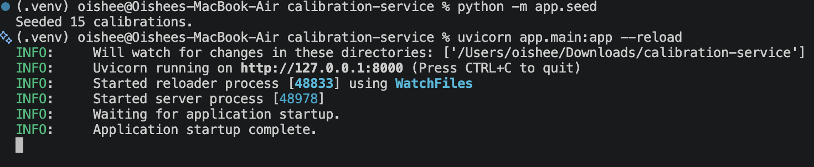

## 3. How to observe correctness

There are three ways to check the service, from fastest to most hands-on. I did A and B
myself (section 4 is my run of B). C is the same thing from the browser.

**A. Run the automated tests.** 54 tests, no server needed, about a second.

```bash
python -m pytest -q          # expect: 54 passed
python -m pytest -v          # same, listing every test
```

(A harmless `httpx` deprecation warning from FastAPI's test client may appear.)

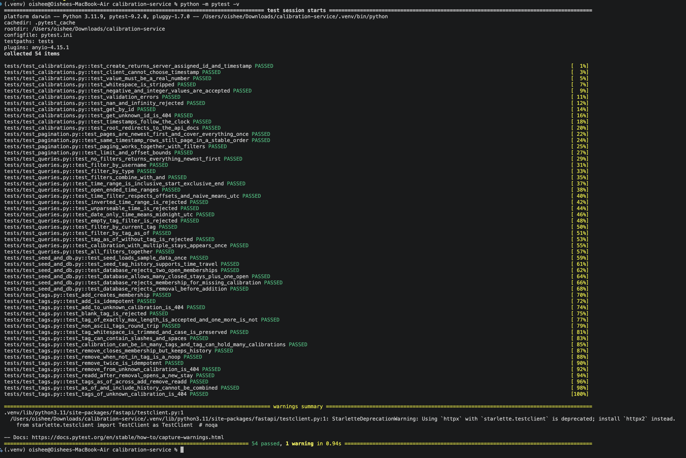

**B. Use the command line.** Call the API with `curl` and look at the database with
`sqlite3`. Section 4 does exactly this, one use case at a time, so every request has a
visible effect in the data.

**C. Use the browser docs.** Open http://127.0.0.1:8000/docs, expand an endpoint, click
**Try it out**, fill in the fields and click **Execute**. The response body and status code
appear right below. This is the quickest way to try things without typing curl.

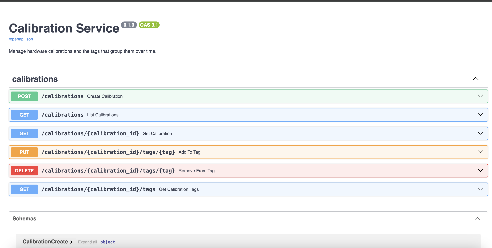

To look inside the database in any of these:

```bash
sqlite3 -header -column calibrations.db "select * from calibrations;"
sqlite3 -header -column calibrations.db "select * from tag_memberships;"
```

If you don't have the `sqlite3` command, use Python:

```bash
python -c "import sqlite3; [print(r) for r in sqlite3.connect('calibrations.db').execute('select * from tag_memberships')]"
```

## 4. Demo walkthrough

This is the demo I ran myself, in order, in a second terminal in the project folder with the
virtual environment active and the server running. The outputs and screenshots are from that
run, and you can repeat every command. Your timestamps will differ, and your ids will differ
if you've created extra rows.

For each use case I did the same three things: sent a normal request, checked the database to
see what it wrote, then tried the edge cases and checked what the service and the database did.

Tips for reading output:

- Add `-w '\nHTTP %{http_code}\n'` to a curl command to print the status code after the
  response.
- Add `| python3 -m json.tool` to print JSON nicely. Use one or the other per command.

### 4.0 The seeded data

First I looked at what the seed script loaded: the 15 calibrations from the brief, plus a small
tag history I added so the time-based queries have something to show.

```bash
sqlite3 -header -column calibrations.db "select * from calibrations;"
sqlite3 -header -column calibrations.db "select * from tag_memberships;"
```

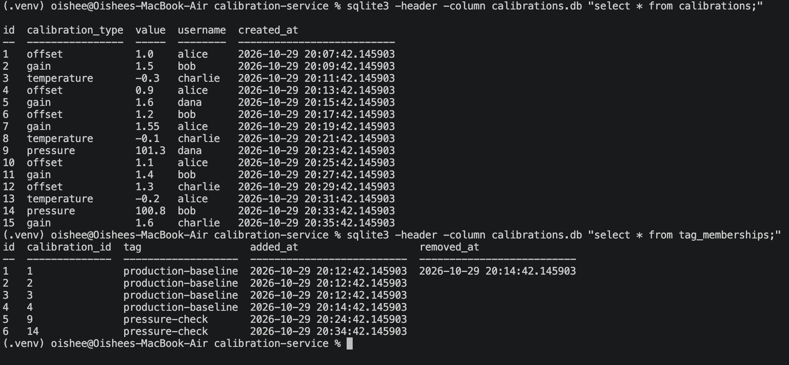

`calibrations` has ids 1 to 15, created two minutes apart (so there are different times to
filter on). `tag_memberships` has six rows:

| id | calibration | tag | story |
|---|---|---|---|
| 1 | 1 | production-baseline | added, then removed (has a `removed_at`) |
| 2 | 2 | production-baseline | still in the tag |
| 3 | 3 | production-baseline | still in the tag |
| 4 | 4 | production-baseline | added when calibration 1 was removed (4 replaced 1) |
| 5 | 9 | pressure-check | still in the tag |
| 6 | 14 | pressure-check | still in the tag |

The key idea: **tag membership is stored as stays.** Each row is one stay of a calibration
in a tag. An empty `removed_at` means "in the tag right now". Removing a calibration fills in
`removed_at` and keeps the row. Adding it again later creates a new row. That is what makes
previous states of a tag answerable.

### 4.1 Create a calibration

```bash
curl -s -w '\nHTTP %{http_code}\n' -X POST http://127.0.0.1:8000/calibrations \
  -H 'Content-Type: application/json' \
  -d '{"calibration_type":"gain","value":2.5,"username":"erin"}'
```

```
{"id":16,"calibration_type":"gain","value":2.5,"username":"erin","created_at":"2026-10-29T21:08:31.493249Z"}
HTTP 201
```

The server chose `id` and `created_at`. I then checked the database:

```bash
sqlite3 -header -column calibrations.db "select * from calibrations where id=16;"
```

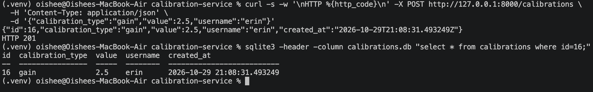

**Edge cases I tried.** Each of these was rejected with `422` (or `404`) and nothing was saved:

```bash
# value sent as a string
curl -s -w '\nHTTP %{http_code}\n' -X POST http://127.0.0.1:8000/calibrations -H 'Content-Type: application/json' \
  -d '{"calibration_type":"gain","value":"1.5","username":"erin"}'
# username that is only spaces
curl -s -w '\nHTTP %{http_code}\n' -X POST http://127.0.0.1:8000/calibrations -H 'Content-Type: application/json' \
  -d '{"calibration_type":"gain","value":1.5,"username":"   "}'
# client tries to choose its own timestamp
curl -s -w '\nHTTP %{http_code}\n' -X POST http://127.0.0.1:8000/calibrations -H 'Content-Type: application/json' \
  -d '{"calibration_type":"gain","value":1.5,"username":"erin","created_at":"1999-01-01T00:00:00Z"}'
# NaN
curl -s -w '\nHTTP %{http_code}\n' -X POST http://127.0.0.1:8000/calibrations -H 'Content-Type: application/json' \
  -d '{"calibration_type":"gain","value":NaN,"username":"erin"}'
# a calibration that doesn't exist
curl -s -w '\nHTTP %{http_code}\n' http://127.0.0.1:8000/calibrations/9999
```

| Input | Result | Why |
|---|---|---|
| `"value": "1.5"` | 422 `Input should be a valid number` | Strict typing. Without it `"1.5"` and `true` would be silently converted. |
| blank username | 422 `String should have at least 1 character` | Whitespace is trimmed before the length check. |
| `created_at` in the body | 422 `Extra inputs are not permitted` | Only the server sets the time. Silently ignoring it would let a client think it had set it. |
| `NaN` | 422 `Input should be a finite number` | NaN and Infinity are not measurements. |
| unknown id | 404 | |

To confirm nothing bad was saved, I counted the rows again:

```bash
sqlite3 calibrations.db "select count(*) from calibrations;"    # 16, unchanged
```

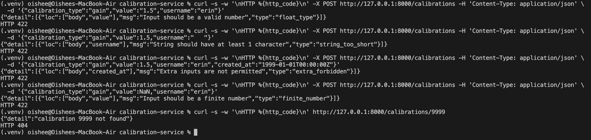
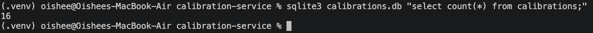

### 4.2 Add a calibration to a tag

```bash
curl -s -w '\nHTTP %{http_code}\n' -X PUT http://127.0.0.1:8000/calibrations/16/tags/golden
```

```
{"calibration_id":16,"tag":"golden","added_at":"2026-10-29T21:10:54.879112Z","removed_at":null}
HTTP 201
```

```bash
sqlite3 -header -column calibrations.db "select * from tag_memberships where calibration_id=16;"
```

One new row (id 7), with an empty `removed_at`.

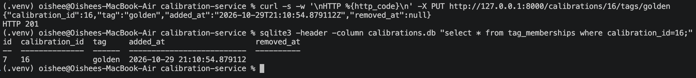

**Edge cases I tried:**

```bash
# the same request again
curl -s -w '\nHTTP %{http_code}\n' -X PUT http://127.0.0.1:8000/calibrations/16/tags/golden
# a tag containing a slash and a space
curl -s -w '\nHTTP %{http_code}\n' -X PUT "http://127.0.0.1:8000/calibrations/16/tags/fab/lot%207"
# different capitalisation
curl -s -w '\nHTTP %{http_code}\n' -X PUT http://127.0.0.1:8000/calibrations/16/tags/Golden
# blank tag
curl -s -w '\nHTTP %{http_code}\n' -X PUT "http://127.0.0.1:8000/calibrations/16/tags/%20%20"
# calibration that doesn't exist
curl -s -w '\nHTTP %{http_code}\n' -X PUT http://127.0.0.1:8000/calibrations/9999/tags/golden
```

| Input | Result | Why |
|---|---|---|
| repeat of the same add | **200**, same `added_at` | Adding is idempotent. A retry can't create a duplicate. 201 means "new", 200 means "already there". |
| `fab/lot%207` | 201, stored as `fab/lot 7` | Tags are arbitrary strings, including slashes and spaces. |
| `Golden` | 201, a separate row from `golden` | Tags are case-sensitive. |
| blank tag | 422 `tag must not be empty` | |
| unknown calibration | 404 | |

```bash
sqlite3 -header -column calibrations.db "select id, tag, added_at, removed_at from tag_memberships where calibration_id=16;"
```

Three rows (`golden`, `fab/lot 7`, `Golden`). The repeated request did not add a fourth.

**Database-level guarantee.** A calibration can't be in the same tag twice at once, and
that rule is enforced by the database itself, not only by the application code. It is a
unique index that only covers rows where `removed_at IS NULL`:

```bash
sqlite3 calibrations.db ".indexes tag_memberships"
# look for: uq_membership_one_open_stay
```

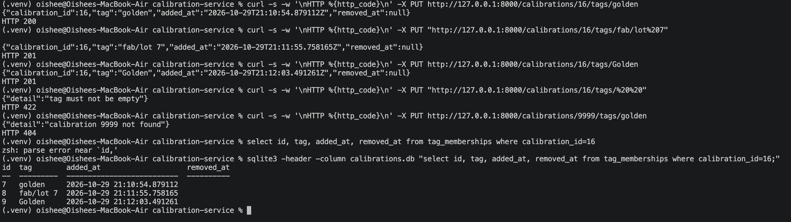

### 4.3 Remove a calibration from a tag

```bash
curl -s -w 'HTTP %{http_code}\n' -X DELETE http://127.0.0.1:8000/calibrations/16/tags/golden
# HTTP 204   (no body)
```

```bash
sqlite3 -header -column calibrations.db "select * from tag_memberships where calibration_id=16;"
```

The `golden` row is **still there**, now with `removed_at` filled in. Nothing was deleted;
that row is the history.

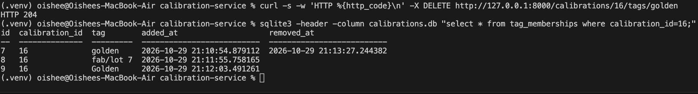

**Edge cases I tried:**

```bash
curl -s -w 'HTTP %{http_code}\n' -X DELETE http://127.0.0.1:8000/calibrations/16/tags/golden        # again
curl -s -w 'HTTP %{http_code}\n' -X DELETE http://127.0.0.1:8000/calibrations/16/tags/never-added   # never in it
curl -s -w '\nHTTP %{http_code}\n' -X DELETE http://127.0.0.1:8000/calibrations/9999/tags/golden    # unknown calibration
```

| Input | Result | Why |
|---|---|---|
| remove twice | 204, nothing changes | Removing is idempotent. |
| remove from a tag it was never in | 204, nothing changes | Same reason. |
| unknown calibration | 404 | That is more likely a typo than a retry, so it's worth reporting. |

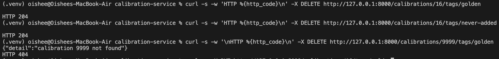

**Re-adding after removal.** I added `golden` again to check that it opens a new stay and leaves the old one untouched:

```bash
curl -s -X PUT http://127.0.0.1:8000/calibrations/16/tags/golden
sqlite3 -header -column calibrations.db "select id,tag,added_at,removed_at from tag_memberships where calibration_id=16 and tag='golden';"
```

Two rows: the finished stay (with `removed_at`) and a new open one.

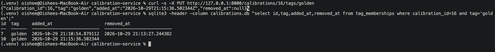

### 4.4 Query the tags of a calibration

```bash
# tags it is in right now
curl -s http://127.0.0.1:8000/calibrations/16/tags | python3 -m json.tool
# every stay it has ever had, including removed ones
curl -s "http://127.0.0.1:8000/calibrations/16/tags?include_history=true" | python3 -m json.tool
```

The first returns the three open stays. The second returns four: the same three plus the
finished `golden` stay. (Results are sorted by tag, so capitalised tags come first.)

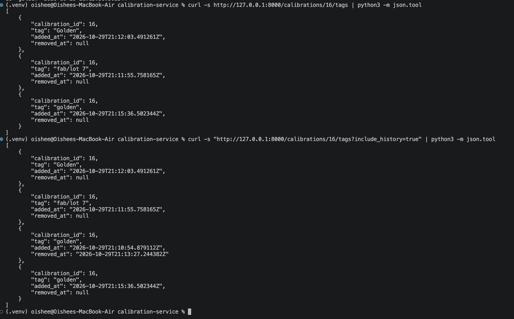

**Looking back in time.** In the seed data, calibration 1 was in `production-baseline` and
was then removed. I took the creation time of calibration 4, which falls between those two
events, and asked what calibration 1's tags were at that moment:

```bash
T4=$(sqlite3 calibrations.db "select created_at from calibrations where id=4")
echo $T4

curl -s http://127.0.0.1:8000/calibrations/1/tags                      # now: []
curl -s -G http://127.0.0.1:8000/calibrations/1/tags --data-urlencode "as_of=$T4" | python3 -m json.tool
```

Now it has no tags (`[]`). As of `$T4` it was in `production-baseline`, and the returned
`removed_at` is later than `$T4`.

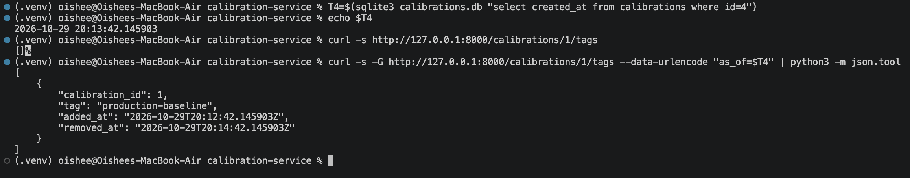

**Edge cases I tried:**

```bash
curl -s -w '\nHTTP %{http_code}\n' "http://127.0.0.1:8000/calibrations/1/tags?as_of=2026-01-01T00:00:00Z&include_history=true"
curl -s -w '\nHTTP %{http_code}\n' "http://127.0.0.1:8000/calibrations/1/tags?as_of=yesterday"
curl -s -w '\nHTTP %{http_code}\n' http://127.0.0.1:8000/calibrations/9999/tags
```

| Input | Result |
|---|---|
| `as_of` together with `include_history` | 422 `as_of and include_history cannot be combined` (they contradict each other) |
| a time that can't be parsed | 422 |
| unknown calibration | 404 |

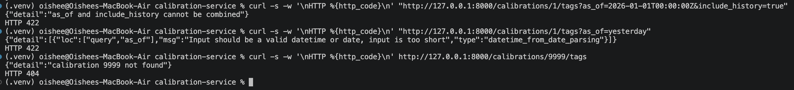

### 4.5 Retrieve calibrations by user, time, type and tag

To keep the output readable I defined a small helper that prints one line per result (paste it once into your terminal):

```bash
q() { curl -s -G http://127.0.0.1:8000/calibrations "$@" | python3 -c "import sys,json;[print(x['id'],x['username'],x['calibration_type'],x['created_at']) for x in json.load(sys.stdin)]"; }
```

Every filter is optional, and the ones you give are combined with AND. Results are newest
first.

```bash
q --data-urlencode username=alice                                            # 13 10 7 4 1
q --data-urlencode calibration_type=gain                                     # 16 15 11 7 5 2
q --data-urlencode username=alice --data-urlencode calibration_type=offset   # 10 4 1
```

**Time window.** `created_after` is inclusive, `created_before` is exclusive:

```bash
T6=$(sqlite3 calibrations.db "select created_at from calibrations where id=6")
T10=$(sqlite3 calibrations.db "select created_at from calibrations where id=10")
q --data-urlencode "created_after=$T6" --data-urlencode "created_before=$T10"   # 9 8 7 6
```

Row 6 is in (inclusive start) and row 10 is out (exclusive end), so two back-to-back
windows never share a row.

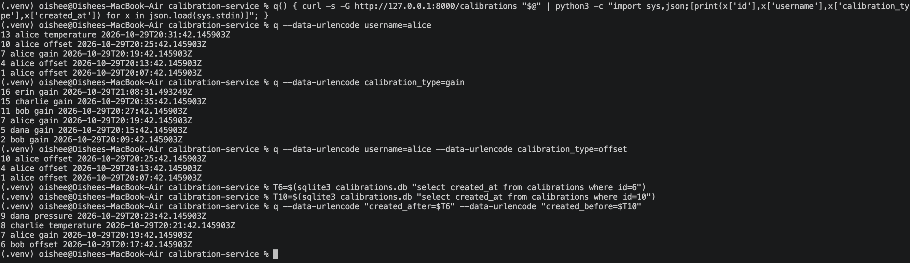

**Tag, now versus in the past:**

```bash
q --data-urlencode tag=production-baseline                                     # 4 3 2
q --data-urlencode tag=production-baseline --data-urlencode "tag_as_of=$T4"    # 3 2 1
```

Same tag, two answers. Today the baseline is calibrations 2, 3 and 4. At the moment
calibration 4 was created it was 1, 2 and 3. Compare with the `tag_memberships` table in
4.0. This is the "current state of a tag, or previous states" requirement.

**Combining filters and paging:**

```bash
q --data-urlencode tag=production-baseline --data-urlencode username=alice   # 4
q --data-urlencode limit=3                                                   # 16 15 14
q --data-urlencode limit=3 --data-urlencode offset=3                         # 13 12 11
```

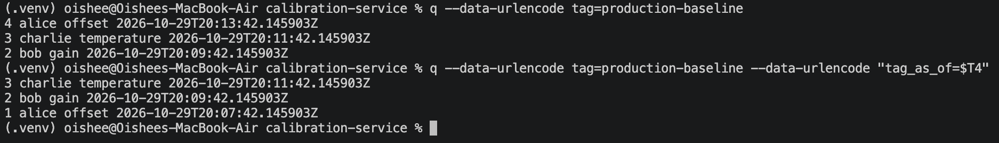
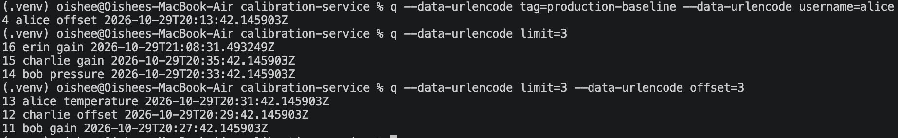

**Edge cases I tried:**

```bash
# window the wrong way round
curl -s -w '\nHTTP %{http_code}\n' -G http://127.0.0.1:8000/calibrations --data-urlencode "created_after=2026-12-01" --data-urlencode "created_before=2026-01-01"
# tag_as_of without a tag
curl -s -w '\nHTTP %{http_code}\n' -G http://127.0.0.1:8000/calibrations --data-urlencode "tag_as_of=2026-12-01"
# a limit that is too small
curl -s -w '\nHTTP %{http_code}\n' "http://127.0.0.1:8000/calibrations?limit=0"
# nothing matches
q --data-urlencode username=nobody
```

| Input | Result |
|---|---|
| `created_after` later than `created_before` | 422 `created_after must be earlier than created_before` |
| `tag_as_of` with no `tag` | 422 `tag_as_of requires tag` |
| `limit=0` (allowed range is 1 to 200) | 422 |
| no matches | `[]`, not an error |

Times with no timezone are treated as UTC. Times with an offset are converted to UTC. If you
type a `+05:00` offset by hand in a URL, write the plus as `%2B`, because a raw `+` in a URL
means a space.

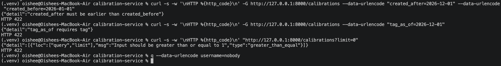

### 4.6 The same thing in the browser (`/docs`)

Everything above can also be done without `curl`. Open http://127.0.0.1:8000/docs and:

1. Expand **POST /calibrations**, click **Try it out**, edit the example body, click
   **Execute**. The response (with status 201) is shown below the button.
2. Expand **PUT /calibrations/{calibration_id}/tags/{tag}**, enter `16` and `golden`, Execute.
3. Expand **GET /calibrations**, type `production-baseline` in `tag`, Execute. Then paste a
   timestamp into `tag_as_of` and Execute again to see the past state.
4. Expand **GET /calibrations/{calibration_id}/tags**, enter `1`, tick `include_history`.

The docs page is generated from the code, so it always matches the real API.


## 5. API reference

| Method and path | Body / query | Success | Errors |
|---|---|---|---|
| `POST /calibrations` | JSON: `calibration_type` (1-64 chars), `value` (number), `username` (1-64 chars) | 201 with the new calibration | 422 invalid input |
| `GET /calibrations/{id}` | | 200 | 404 |
| `GET /calibrations` | `username`, `calibration_type`, `created_after`, `created_before`, `tag`, `tag_as_of`, `limit` (1-200, default 50), `offset` (default 0) | 200, a JSON array, newest first | 422 |
| `PUT /calibrations/{id}/tags/{tag}` | | 201 added, 200 already in the tag | 404, 422 |
| `DELETE /calibrations/{id}/tags/{tag}` | | 204 always (also when it wasn't in the tag) | 404 unknown calibration, 422 |
| `GET /calibrations/{id}/tags` | `as_of` or `include_history` (not both) | 200, a JSON array of stays | 404, 422 |

A "stay" in a response looks like
`{"calibration_id": 1, "tag": "production-baseline", "added_at": "...", "removed_at": null}`.
`removed_at` is `null` while the calibration is still in the tag.

All timestamps are UTC. `/docs` (Swagger UI) and `/openapi.json` document every field.

## 6. Design and background

**Stack.** FastAPI for the HTTP layer (automatic validation and the `/docs` page),
Pydantic for request and response shapes, SQLAlchemy for the database access, and SQLite as
the relational database, so there is nothing to install or configure.

**Layers.** The code is split so each file has one job:

- `main.py` is only the HTTP layer. It reads the request, calls a function in `service.py`
  and turns the result or the error into a response.
- `service.py` holds every rule. It knows nothing about HTTP, so the seed script and the
  tests call it directly.
- `models.py` defines the two tables. `schemas.py` defines the JSON shapes.
- `database.py` creates the engine and a session per request.
- `clock.py` is the one place the app reads the current time, so tests can control it.

**Tag history as stays.** The central design decision. I could have stored "calibration X is
in tag Y" as a single row and deleted it on removal, but then past states are lost. Instead,
`tag_memberships` stores one row per stay, with `added_at` and `removed_at`. Removing fills in
`removed_at`. Re-adding creates a new row.

- *In the tag now* means `removed_at IS NULL`.
- *In the tag at time T* means `added_at <= T AND (removed_at IS NULL OR removed_at > T)`.
  The interval is half open, so a stay that ends at 10:00 and one that starts at 10:00 never
  both match the same instant.

**Rules the database enforces itself.** These hold even if the application code had a bug:

- a foreign key (a membership must point at a real calibration),
- a check constraint (a stay can't end before it starts),
- a unique index on `(calibration_id, tag)` limited to open stays, so a calibration can't be
  in the same tag twice at once. If two requests add the same tag at the same moment, the
  database rejects the second insert and the service returns the row that already exists.

**Timestamps.** The server assigns `created_at`, always in UTC. SQLite has no timezone
support and compares times as text, so a small custom column type converts everything to UTC
on the way in and labels it UTC on the way out.

**Idempotency.** PUT and DELETE can be repeated safely, which matters because clients retry.
POST is not idempotent (two POSTs make two calibrations), as is normal.

**Filtering by tag.** The tag filter uses `id IN (subquery)`. A calibration can have several
rows for one tag (added, removed, added again), and `IN` returns it once however many rows
match, where a join would repeat it.

**Pagination.** `limit` and `offset`, ordered by `created_at` then `id` descending. The id
breaks ties between calibrations created at the same instant, so the order is stable.

## 7. Tests

Run everything with `python -m pytest -q`, or one file with
`python -m pytest tests/test_tags.py -v`.

Tests don't use `calibrations.db`. Each test gets its own empty in-memory database and a fake
clock that only moves when the test says so. That makes "what was in the tag an hour ago"
tests instant and repeatable.

| File | Tests | What it covers |
|---|---|---|
| `tests/conftest.py` | n/a | Shared setup: the in-memory database, the fake clock, the test client, and a helper that creates calibrations through the API. |
| `tests/test_calibrations.py` | 11 | **Use case 1.** Server assigns id and timestamp, clients can't set `created_at`, strict value typing, NaN and Infinity rejected, whitespace trimmed, negative and integer values accepted, validation errors, fetch by id, unknown id gives 404, timestamps follow the clock, `/` redirects to the docs. |
| `tests/test_tags.py` | 17 | **Use cases 2, 3 and 5.** Add, repeated add (200), unknown calibration, blank tag, maximum tag length (255 accepted, 256 rejected), non-ASCII tags, trimming and case sensitivity, slashes and spaces in tags, many-to-many tagging, remove keeps history, removing twice or when not in the tag, re-add opens a new stay, tags as of a past time across add, remove and re-add, `as_of` plus `include_history` rejected, unknown calibration. |
| `tests/test_queries.py` | 16 | **Use case 4.** No filters (newest first), each filter alone, filters combined with AND, inclusive start and exclusive end, open-ended time ranges, time zone offsets and naive times treated as UTC, inverted and unparseable ranges, date-only means midnight UTC, empty tag filter, tag now versus tag as of a past time, `tag_as_of` without a tag, a calibration with several stays appearing only once, all filters together. |
| `tests/test_pagination.py` | 4 | `limit` and `offset`. Pages cover everything exactly once, newest first. Calibrations with identical timestamps keep a stable order. Paging combined with filters. Limit and offset bounds. |
| `tests/test_seed_and_db.py` | 6 | The seed loads 15 rows and is safe to run twice. The seeded tag history gives different answers at different times. The database itself rejects two open stays, a membership for a missing calibration, and a removal before its addition. It allows many closed stays plus one open one. |

## 8. Assumptions and known gaps

Things the brief left open, and the choices I made:

- **"Time" means creation time.** Calibrations are timestamped by the server when created, in
  UTC, and clients can't set it. Filters on time are ranges over that creation time.
- **Tag state over time.** The brief says users may want "previous states of a tag", so
  membership is kept as history instead of being deleted.
- **Tags** are trimmed, case-sensitive, 1 to 255 characters. `Gold` and `gold` are different
  tags. Unicode is not normalised, so visually identical strings can be different tags.
- **Calibrations are immutable.** The five use cases don't include editing or deleting a
  calibration, so there are no endpoints for it.
- **`username` is just a string**, not an account. There is no authentication or users table.
  `calibration_type` is free text, not a fixed list.
- **Idempotent add and remove.** Repeating either is not an error. Removing from a tag the
  calibration isn't in is a 204, not a 404. An unknown calibration is a 404.
- **Seed data.** The brief gave only the 15 calibrations. I gave them creation times two
  minutes apart ending about half an hour before you run the seed, and added a small tag
  history (the `production-baseline` swap and a `pressure-check` tag) purely so the time-based
  queries have something to show.
- **Times with no timezone are treated as UTC.**

Known limits:

- **SQLite only**, and the tables are created at startup with `create_all`, with no migration
  tool. Changing a model later means deleting `calibrations.db` or adding something like
  Alembic. Moving to PostgreSQL would mostly mean changing the connection URL
  (`DATABASE_URL`), but I have not tested that.
- **Offset paging** can skip or repeat a row if calibrations are created while someone is
  paging through. Cursor-based paging would fix that; it isn't needed at this scale.
- **Server clock.** Timestamps come from the server clock. If the clock were set backwards
  between an add and a remove, the database's check constraint would reject the removal.
- **Very large ids** (above the 64-bit range) are not specially handled and give a 500 error
  from the database instead of a 404.
- **Plus signs in URLs.** An unencoded `+` in a timezone offset in a query string is read as
  a space. Use `%2B`.
- **Not production-ready:** no authentication, no rate limiting, no logging configuration,
  and a single SQLite file written by one server process.

## 9. Project layout

```
calibration-service/
├── app/
│   ├── main.py          HTTP routes and error handling
│   ├── service.py       business rules
│   ├── models.py        database tables
│   ├── schemas.py       request/response shapes
│   ├── database.py      engine and session setup
│   ├── clock.py         "what time is it" (replaceable in tests)
│   ├── seed.py          loads the sample data
│   └── seed_data.json   the 15 calibrations from the brief
├── tests/               see section 7
├── docs/screenshots/    images used in this README
├── requirements.txt
├── pytest.ini
└── README.md
```
